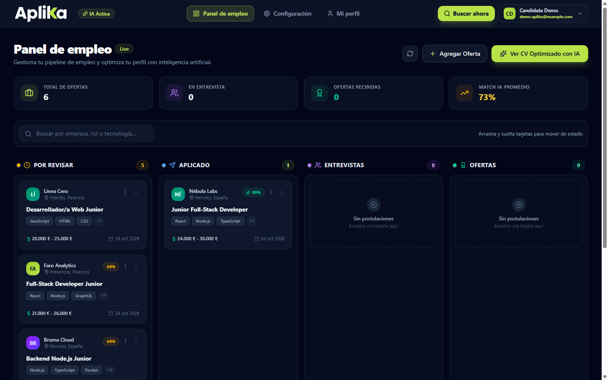
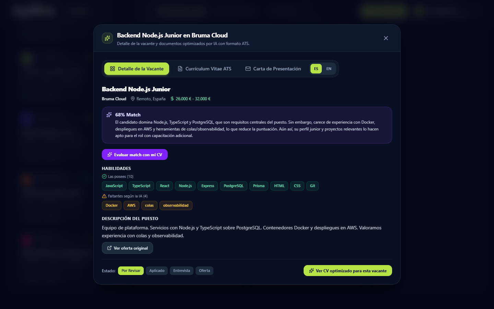
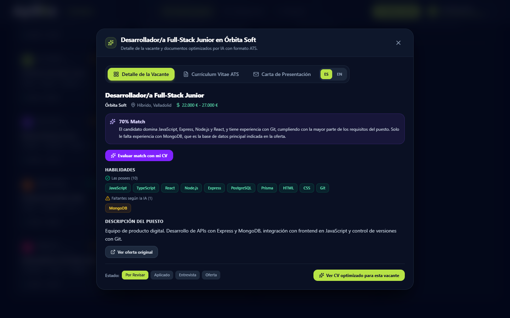

# Aplika Jobs — caso de estudio

Aplika Jobs es una plataforma Full-Stack que convierte la búsqueda de empleo dispersa en un flujo de trabajo: extrae el perfil de un CV, busca ofertas, calcula la compatibilidad con IA y prepara un CV adaptado a ATS, una carta y un email.

[Demo pública](https://aplika-jobs.vercel.app) · [Arquitectura](docs/arquitectura.md) · [Decisiones](docs/decisiones.md) · [Fragmentos](docs/fragmentos/) · [Mi perfil](https://www.linkedin.com/in/edu84gp/)

> **Proyecto en equipo.** Aplika Jobs está desarrollado por Eduardo García Prieto y Roberto Antonio López. Este repositorio documenta mi aportación técnica y no contiene el código propietario completo. La marca, el producto y el código pertenecen a sus autores. Ver [NOTICE.md](NOTICE.md).
>
> **Resumen.** Aplika Jobs centraliza ofertas, calcula su compatibilidad con IA y prepara CV, carta y email adaptados. Mi aportación se centró en el backend y la integración de IA: API REST, PostgreSQL/Prisma, motor de búsqueda, matching, autenticación y calidad. El código completo es privado; este repositorio documenta la arquitectura, las decisiones y cuatro fragmentos saneados.

## El problema

Buscar empleo técnico genera dos problemas difíciles de sostener en el tiempo. Por un lado, las ofertas están repartidas entre portales, alerts y newsletters. Por otro, adaptar el CV y la carta a cada oferta consume tiempo y suele hacerse sin saber qué palabras clave está buscando el filtro ATS.

Aplika Jobs ataca ese problema como un CRM de empleo: centraliza las ofertas, prioriza las que encajan con el perfil y prepara materiales adaptados sin inventar experiencia.

## La solución

1. El usuario sube su CV en PDF.
2. La IA extrae un perfil estructurado: experiencia, formación, proyectos, skills, idiomas y objetivo.
3. Un cron diario y un disparador manual buscan ofertas reales mediante JSearch.
4. Un agente evalúa cada oferta y devuelve una puntuación, un motivo y las skills que faltan.
5. Los matches se convierten en tarjetas de un tablero Kanban.
6. El optimizador genera un CV adaptado a la oferta, una carta y un email, con caché y edición posterior.

## Mi aportación

Mi trabajo se centró en el backend y en la integración de IA:

- Contribuí al diseño y desarrollo de la API REST con Express 5 y TypeScript estricto.
- Modelé el dominio y la persistencia con PostgreSQL, Supabase, Prisma 7 y migraciones.
- Implementé el motor de búsqueda con JSearch, cron, deduplicación, caducidad y persistencia por lotes.
- Implementé el orquestador de matching con estados, umbral configurable, reintentos y creación de candidaturas.
- Contribuí al optimizador ATS y a la generación de carta y email con Groq y OpenAI como fallback.
- Implementé autenticación JWT, bcrypt, RBAC y el intercambio de OAuth de Google y LinkedIn con Supabase.
- Contribuí a la integración del frontend React/Vite con la API en autenticación y flujos de datos.
- Añadí rate limiting con Redis y fallback a memoria, validación con Zod y un manejador de errores tipado.
- Mantuve los controles de calidad: TypeScript, Biome, Prisma validate, documentación y revisión de endpoints.

La autoría del producto es compartida. El diseño de producto, QA y partes del extractor de CV y de los prompts se desarrollaron en equipo.

## Funcionalidades

| Área | Qué hace |
| --- | --- |
| Perfil | Subida de PDF, extracción con IA y edición del perfil base |
| Búsqueda | Ofertas reales con JSearch, cron diario, disparo manual y deduplicación |
| Matching | Puntuación 0-100, motivo, skills faltantes y umbral configurable |
| Seguimiento | Tablero Kanban con estados de candidatura y ofertas manuales |
| Optimización | CV adaptado a ATS, carta, email, caché y edición parcial |
| Seguridad | JWT, bcrypt, RBAC, OAuth, validación Zod, CORS y rate limit |
| Observabilidad | Logs estructurados con Pino y métricas del ciclo de búsqueda |

## Stack

**Stack principal:** Node.js, TypeScript, Express, PostgreSQL, Prisma, Groq/OpenAI y JSearch.

**También he trabajado con:** React, Vite, Tailwind CSS, Redis, Supabase Auth, Render y Vercel.

| Capa | Tecnologías |
| --- | --- |
| Backend | Node.js 20, TypeScript, Express 5 |
| Datos | PostgreSQL en Supabase, Prisma 7 y migraciones |
| IA | Groq, OpenAI como fallback y salida JSON |
| Búsqueda | JSearch mediante RapidAPI y node-cron |
| Seguridad | JWT, bcrypt, RBAC, Zod, OAuth Google/LinkedIn y rate limit con Redis |
| Frontend | React y Vite, desarrollado en equipo |
| Infraestructura | Render para la API, Vercel para el frontend y Supabase para datos y auth |
| Calidad | Biome, TypeScript, Prisma validate y Pino |

El frontend está construido con React y Vite. Contribuí a su integración con la API en autenticación y flujos de datos; el diseño y desarrollo de la interfaz son compartidos con el equipo.

## Arquitectura

La API sigue un MVC adaptado a REST: rutas, controladores finos, servicios por feature y middlewares para auth, validación y errores. La persistencia se concentra en Prisma y las operaciones sensibles se agrupan en transacciones.

El flujo completo, el modelo de datos y el despliegue están en [docs/arquitectura.md](docs/arquitectura.md). Las decisiones con contexto y trade-offs están en [docs/decisiones.md](docs/decisiones.md).

## Vista del producto

Las capturas usan una cuenta y datos ficticios: «Candidata Demo», el correo reservado `demo.aplika@example.com` y seis empresas de ejemplo creadas para la demostración. Las ofertas se crearon manualmente y no proceden de JSearch. Para la demostración se ajustó el umbral de compatibilidad y se evaluaron las ofertas con el perfil ficticio. Los porcentajes son la salida del matching sobre ese perfil y no representan resultados medidos del producto. Cualquier coincidencia con empresas reales es casual.

La demo pública abre un panel de demostración con una sesión automática y datos ficticios; para usar el producto completo hay que crear una cuenta.

## Fragmentos comentados

| Fragmento | Qué demuestra |
| --- | --- |
| [Validación de entrada con Zod](docs/fragmentos/01-validacion-zod.md) | Contratos explícitos antes del controlador |
| [Persistencia por lotes con Prisma](docs/fragmentos/02-persistencia-lotes-prisma.md) | Transacciones, deduplicación e idempotencia |
| [Orquestación de matching](docs/fragmentos/03-orquestacion-matching.md) | Estados, concurrencia y creación de candidaturas |
| [Ruta protegida](docs/fragmentos/04-ruta-protegida.md) | Auth, validación y límites por endpoint |

Los fragmentos son versiones reducidas y saneadas. No incluyen el código completo, prompts internos, pesos, credenciales, esquema real ni datos de usuarios.

## Resultados y aprendizajes

- El backend cubre el ciclo completo: CV, perfil, ofertas, matching, candidatura, CV adaptado y carta.
- La persistencia por lotes y los estados de matching evitan duplicados y dobles procesamientos.
- La integración con IA está aislada del dominio y tolera fallos del proveedor sin perder el estado.
- Aprendí a diseñar límites transaccionales, idempotencia, contratos tipados y errores recuperables en un flujo con IA.
- No publico métricas de conversión ni de entrevistas porque no existe una medición controlada.

## Límites

- La demo pública abre el panel en modo demostración con una sesión automática y datos ficticios; no contiene datos de usuarios reales. Las capturas se tomaron con una cuenta ficticia creada para la demostración.
- La IA depende de la cuota y latencia de proveedores externos.
- Los motivos generados por la IA pueden usar un género gramatical distinto al del perfil; es una limitación de redacción del producto.
- El proyecto aún no tiene una suite de tests automatizados; los controles actuales son tipos, lint y validación de Prisma.
- El frontend no forma parte de este repositorio; el caso de estudio se centra en backend e integración.
- Los prompts, pesos, reglas internas, esquema completo y código permanecen privados.

## Propiedad intelectual

El texto, la selección de fragmentos y las capturas de este repositorio se publican únicamente como demostración profesional. No se concede una licencia de uso sobre el producto Aplika Jobs. Consulta [LICENSE](LICENSE) y [NOTICE.md](NOTICE.md).

## Contacto

- LinkedIn: [edu84gp](https://www.linkedin.com/in/edu84gp/)
- GitHub: [edu84gp](https://github.com/edu84gp)
- Demo: [aplika-jobs.vercel.app](https://aplika-jobs.vercel.app)
- Empresa: [Aplika Jobs en LinkedIn](https://www.linkedin.com/company/aplika-jobs/)

Última actualización: 2026-10-25.
