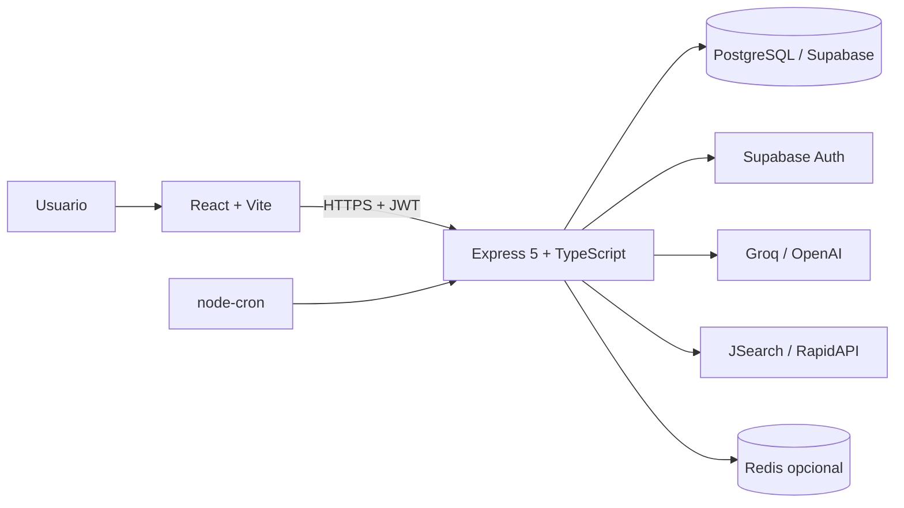
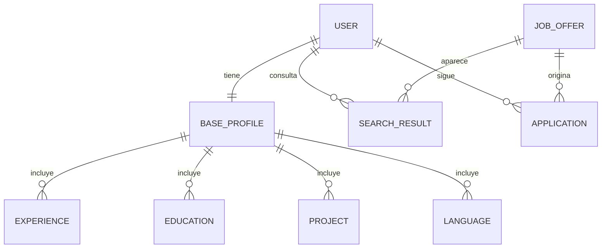

# Arquitectura

## Vista general

Aplika Jobs separa la interfaz, la API y los servicios externos. El frontend consume una API REST con JWT; la API concentra la lógica de negocio, la persistencia y la orquestación de proveedores de IA y empleo.

## Componentes

| Componente | Responsabilidad |
| --- | --- |
| Frontend | Interfaz de perfil, ofertas, tablero, CV y carta |
| API | Rutas, controladores finos, servicios, validación y errores |
| Base de datos | Usuarios, perfiles, ofertas, resultados y candidaturas |
| Proveedor de IA | Extracción, evaluación y generación de textos |
| JSearch | Búsqueda de ofertas reales |
| Supabase Auth | OAuth de Google y LinkedIn |
| Redis | Rate limit compartido cuando está configurado |
| Cron | Ciclo diario de búsqueda |

## Flujo de una petición

1. El frontend envía una petición HTTPS con el token JWT.
2. El middleware de autenticación valida el token y extrae el usuario.
3. El middleware de validación comprueba body, query y params con Zod.
4. El controlador delega en un servicio de dominio.
5. El servicio accede a Prisma, a un proveedor externo o a ambos.
6. El resultado vuelve con una forma de respuesta común.
7. Los errores se centralizan en un manejador tipado.

Los controladores no contienen `try/catch` repetidos: delegan en `next(error)` y el manejador global decide el código HTTP.

## Flujo del CV

1. El usuario sube un PDF por multipart.
2. Multer lo mantiene en memoria y limita el tamaño y el tipo.
3. El parser extrae el texto.
4. El proveedor de IA devuelve un perfil estructurado en JSON.
5. El servicio normaliza la respuesta.
6. Una transacción guarda el perfil base y sus relaciones.
7. El perfil queda disponible para la búsqueda y el matching.

## Flujo de búsqueda y matching

1. El cron o el disparador manual consulta JSearch.
2. El proveedor devuelve ofertas en bruto.
3. El motor normaliza, filtra por antigüedad y deduplica.
4. La persistencia por lotes crea o actualiza ofertas y vínculos.
5. El orquestador reclama resultados pendientes.
6. El agente de matching evalúa cada oferta.
7. El resultado se guarda con puntuación, motivo y skills faltantes.
8. Si supera el umbral, se crea una candidatura en el tablero.
9. El optimizador genera el CV adaptado, la carta y el email.

## Modelo de datos de alto nivel

El modelo real, los nombres internos, las restricciones y las migraciones no se publican. Este diagrama solo explica las relaciones necesarias para entender el flujo.

## Autenticación y seguridad

- JWT interno de corta duración para la API.
- Contraseñas con bcrypt.
- Roles `USER` y `ADMIN` con autorización por middleware.
- OAuth de Google y LinkedIn mediante Supabase Auth.
- Canje de la sesión de Supabase por un JWT interno.
- Validación de variables de entorno al arranque.
- CORS con allowlist.
- Rate limit por IP para auth y endpoints de IA.
- Multer en memoria, solo PDF y tamaño máximo.
- Errores sin detalles internos en producción.

## Despliegue

| Pieza | Plataforma |
| --- | --- |
| Frontend | Vercel |
| API | Render |
| Base de datos | Supabase PostgreSQL |
| OAuth | Supabase Auth |
| Rate limit compartido | Redis o Valkey |

Las migraciones se ejecutan antes del arranque de la API. La configuración se inyecta por variables de entorno; ninguna credencial vive en el repositorio.

## Qué queda privado y por qué

- Código completo del producto.
- Esquema real y migraciones.
- Prompts, reglas, pesos y umbrales internos del matching.
- Configuración de proveedores y credenciales.
- Datos de usuarios y paneles de administración.
- Historial Git del repositorio privado.

El caso de estudio publica documentación, capturas y fragmentos reducidos. No permite reconstruir el producto.

## Límites conocidos

- La demo completa requiere una cuenta.
- La IA depende de cuota, latencia y disponibilidad de terceros.
- No hay suite de tests automatizados; existen controles de tipos, lint y validación de Prisma.
- El frontend no se incluye en este repositorio.
- Las cifras de la landing son mensajes de producto, no métricas verificadas.
